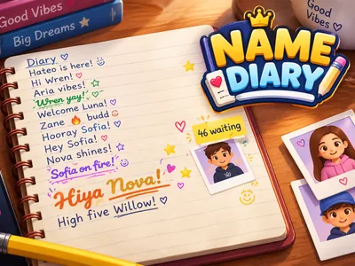
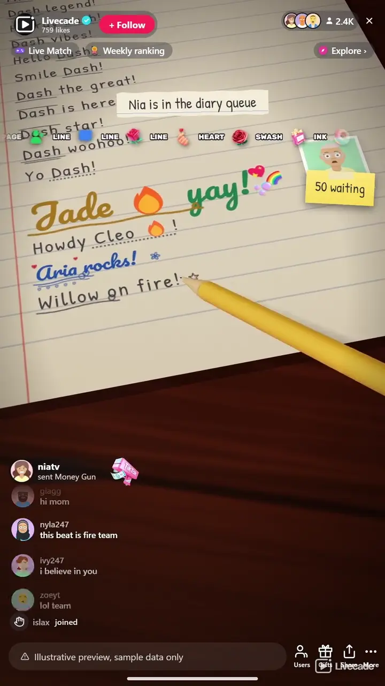

# Name Diary - Interactive TikTok Live Game

> A pencil writes your viewers' names in a diary on your stream, live.

A pencil writes your viewers' names in a diary on your stream, live. A follow or a comment gets a viewer a pencil line, and gifts skip the line for swashes, coloured ink, script, a gold pen with their photo and a page of their own.

**[Play Name Diary on Livecade](https://livecade.io/games/name-diary/?utm_source=github&utm_medium=readme&utm_campaign=name-diary)** - runs as a single browser source in OBS, Streamlabs, or TikTok LIVE Studio. Nothing for viewers to install.

## How viewers play

Viewers take part with the actions TikTok already gives them: **comments**, **follows**, **gifts**, **likes**, **shares**. Every action below is rebindable, so you decide which interaction drives which effect.

| Action | What it does |
| --- | --- |
| **Write a line** | The viewer's name in pencil with one word beside it. From a follow or comment it joins the free line, from a gift it skips it |
| **Heart doodle** | The pencil line with a red heart drawn after it |
| **Swash name** | A long swash under the name and a small doodle |
| **Coloured ink** | The name in coloured ink with a swash |
| **Script name** | The name in a script hand and coloured ink, with a row of hearts |
| **Gold pen** | The pencil is swapped for a gold fountain pen: big gold script, emoji stickers and the viewer's photo dropped on the page |
| **Own page** | A page of their own: "Dear" and their name at the top, a doodled border, their photo and stickers |

## How it works

### Follow or comment, get a line

A follow or any comment puts a viewer in the line, and the pencil writes their name in the diary with one short word beside it.

### Gifts skip the line

A gift writes ahead of the free line, from a Rose's pencil line to a Money Gun's page of their own, and every rung looks different.

### A page at a time

Seventeen lines fill a page, then it is torn out and a fresh page takes its place. A viewer never has two free lines on the same page.

### Speeds up when busy

A plain line takes about three seconds at normal speed, and the pencil writes faster by itself when many viewers are waiting.

## About the game

Name Diary fills your stream with a lined notebook page on a wooden desk in 3D, and a yellow pencil writes your viewers into it. A viewer follows or comments and joins the line. When their turn comes, the pencil writes their TikTok name letter by letter with one short word beside it, like "Hiya Mia!" or "Dash legend!", then draws a line under or over it. Seventeen lines fill a page. Then the page is torn out and slides off the desk, and the pencil writes the heading on the fresh page underneath.

### A fancier line for every gift

Out of the box a Rose writes the same pencil line ahead of the free line, a Finger Heart adds a red heart doodle, a Rosa a long swash and a doodle, a Perfume writes the name in coloured ink, and a Doughnut in a script hand with a row of hearts. A Hand Heart swaps the pencil for a gold fountain pen: the name in big gold script, colour emoji stickers pressed on beside it and the viewer's profile picture dropped onto the page as a polaroid. A Money Gun gets a page of their own, with "Dear" and their name as the heading, a doodled border, their polaroid and stickers in the corners.

### Every name as it was written

Names go on the page the way viewers wrote them: emoji in colour, fancy letters and symbols, Arabic from right to left, Hindi, Cyrillic and Vietnamese. A viewer never has two free lines on the same page, so one regular cannot fill it, and a name that holds one of your mute words is written with a friendly word in its place.

### Every gift writes

A gift with no trigger of its own still writes by its value: every 500 TikTok coins a page of their own, every 100 a gold pen line, every 30 a script line, and below that coloured ink, a swash, a heart or a plain line, up to 20 lines, 3 gold pen lines and 1 page from one send. Turn that setting off and only the gifts you bound write.

## What it looks like on stream

[Watch Name Diary gameplay](https://cdn.livecade.io/games/name-diary.mp4)

## What you can configure

- **Language** - Thirteen languages for the words beside each name, the page heading, the queue and the trigger labels
- **Page title** - Your own heading for every page, or "Diary" in the game's language
- **Writing speed** - Slow, normal or fast. The pencil also speeds up by itself when many viewers are waiting
- **Unbound gifts write by coin value** - A gift with no trigger of its own still writes: every 500 TikTok coins a page of their own, every 100 a gold pen line, every 30 a script line, and less writes ink, a swash, a heart or a plain line

## Languages

English, Spanish, Portuguese, French, German, Italian, Indonesian, Arabic, Turkish, Russian, Hindi, Romanian, Filipino

## FAQ

<strong>How do viewers get their name in Name Diary?</strong>

Out of the box a follow or any comment puts them in the line for a pencil line. Every trigger can be rebound, so likes, shares or any gift can be the way in instead.

<strong>What is written beside a name?</strong>

One short, friendly word in the game's language, before or after the name, such as "Hiya Mia!" or "Dash legend!". The same word is never used twice on one page.

<strong>What do gifts do?</strong>

A gift writes ahead of everyone waiting for a free line. By default a Rose writes a pencil line, a Finger Heart adds a heart doodle, a Rosa a swash, a Perfume coloured ink, a Doughnut a script name, a Hand Heart a gold pen line with stickers and the viewer's photo, and a Money Gun a page of their own. Every gift with a trigger writes, streaks included, and a gift with no trigger of its own writes by its coin value.

<strong>Can a viewer be written more than once?</strong>

Yes. A viewer has one free line waiting at a time and never gets two free lines on the same page, so they can come back on a later page. Gift lines are written every time.

<strong>Does it keep up with a big stream?</strong>

The free line holds up to 200 viewers and gifts always go to the front. The pencil writes faster on its own when eight or more viewers are waiting.

<strong>Will Name Diary run on my PC?</strong>

It renders in 3D on the computer running your stream, so give it a reasonably modern machine. Try it in the dashboard preview before you go live.

<strong>How do I add Name Diary to my TikTok Live?</strong>

Add one browser source URL to OBS or your streaming software and go live. There is no plugin to install and nothing for your viewers to download.

## Setup

1. [Create a Livecade account](https://app.livecade.io/register?utm_source=github&utm_medium=cta&utm_campaign=name-diary)
2. Copy your overlay browser source URL
3. Paste it into OBS, Streamlabs, or TikTok LIVE Studio
4. Pick Name Diary, set your triggers, and go live

Runs in the browser, so it works on Windows and macOS with nothing to download. [See all TikTok Live games](https://livecade.io/tiktok-live-games/?utm_source=github&utm_medium=readme&utm_campaign=name-diary).

---

_This repository documents Name Diary, a hosted interactive game by [Livecade](https://livecade.io/?utm_source=github&utm_medium=footer&utm_campaign=name-diary). The game runs on Livecade's platform, so there is no source to install here._
